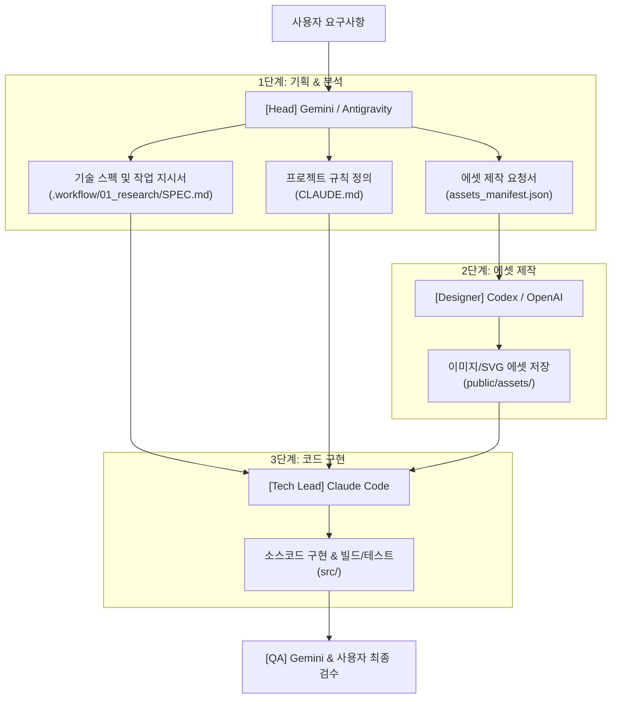

# Multi-AI Collaborative Orchestration Guide
> **Claude Code × Codex/OpenAI × Gemini/Antigravity 협업 파이프라인 구축 가이드**

각 AI 모델의 특화 강점을 결합하여 개발 생산성을 극대화하기 위한 다중 AI(Multi-AI) 협업 아키텍처 및 실전 연동 가이드입니다.

---

## 1. 역할 분담 (R&R Matrix)

| 역할 | 담당 AI | 핵심 강점 및 주 업무 |
| :--- | :--- | :--- |
| **Head (총괄 PM / 아키텍트)** | **Gemini / Antigravity** | 200만+ 토큰 기반 컨텍스트 유지, 자료 조사, 아키텍처 기획, 태스크 분해(`SPEC.md`), 최종 QA |
| **Tech Lead (개발 실무 총괄)** | **Claude Code** | 터미널 CLI 기반 코드베이스 탐색, 코드 작성/리팩터링, 빌드/테스트 통과, Git 커밋 |
| **Designer (비주얼 에셋 제작)** | **Codex / OpenAI** | UI 아이콘, 로고, 배너, 목업 이미지 생성 (DALL-E 3 / Canvas / Flux API 연동) |

---

## 2. 협업 아키텍처 (Workflow Pipeline)



---

## 3. 연동 방안

### ① Model Context Protocol (MCP) 기반 표준 연동
Antigravity와 Claude Code는 모두 Anthropic의 오픈 표준인 **MCP**를 기본 지원합니다. 공통 로컬 MCP 서버를 등록하여 도구와 리소스를 공유합니다.

* **Image Generator MCP**: OpenAI DALL-E / Flux API를 연동하여 프롬프트로 에셋 자동 생성
* **Docs & Knowledge MCP**: 방대한 레퍼런스 문서를 공유 벡터 인덱스로 관리

### ② 아티팩트 핸드오프 (Artifact Handoff) 디렉터리 구조
Git 저장소의 정형화된 폴더 구조를 통해 상태 충돌 없이 작업을 인수인계합니다.

```
project-root/
├── .workflow/
│   ├── 01_research/      # [Gemini] 조사 자료, 벤치마크, SPEC.md
│   ├── 02_assets/        # [Codex] 생성된 비주얼 에셋 및 manifest
│   └── 03_tickets/       # 작업별 분해된 세부 지시서
├── public/assets/        # 클로드 코드가 참조할 최종 이미지/아이콘
├── src/                  # 클로드 코드가 작성하는 실제 애플리케이션 코드
├── CLAUDE.md             # 클로드 코드가 자동 참조하는 프로젝트 컨텍스트/규칙
└── run_pipeline.ps1      # 파이프라인 자동화 실행 스크립트
```

### ③ 파이프라인 자동화 스크립트 (`run_pipeline.ps1`)

```powershell
param (
    [string]$Task = "사용자 대시보드 페이지 구현"
)

Write-Host ">>> [1/3] Gemini/Antigravity: 스펙 및 기획서 생성..." -ForegroundColor Cyan
python scripts/generate_spec.py --task "$Task" --out ".workflow/01_research/SPEC.md"

Write-Host ">>> [2/3] OpenAI/Codex: 시각 에셋 생성..." -ForegroundColor Cyan
python scripts/generate_assets.py --spec ".workflow/01_research/SPEC.md" --out "public/assets"

Write-Host ">>> [3/3] Claude Code: 코드 구현 및 테스트 검증..." -ForegroundColor Green
claude -p ".workflow/01_research/SPEC.md에 따라 public/assets의 에셋을 반영하여 구현하고 테스트를 통과시켜줘."
```

---

## 4. 유용한 오픈소스 도구
* **[LiteLLM](https://github.com/BerriAI/litellm)**: Gemini, Claude, OpenAI API 규격을 통합 라우팅하는 프록시
* **[Fabric](https://github.com/danielmiessler/fabric)**: CLI 유닉스 파이프(`|`) 기반 LLM 프롬프트 오케스트레이션
* **[CrewAI](https://github.com/crewAIInc/crewAI)**: 기획(Gemini) - 디자인(OpenAI) - 코딩(Claude) 에이전트 간 역할 기반 협업 프레임워크
